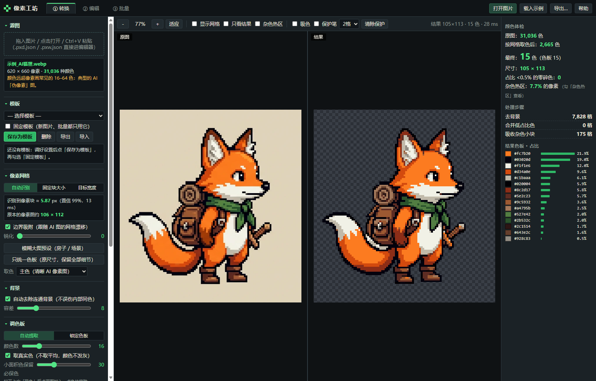
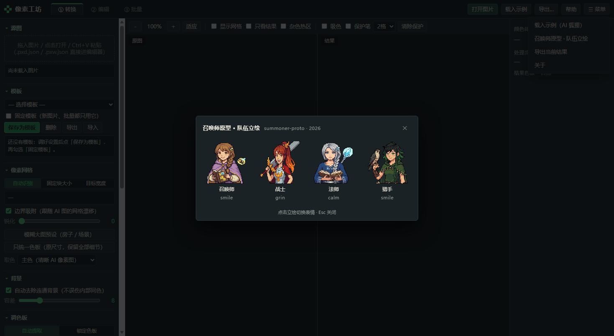

# Pixel Workshop（ピクセル工房）

[中文](README.zh-CN.md) | [English](README.md) | **日本語**

> v1.4.0 · MIT · 単一ファイル・オフライン動作 · [最新版をダウンロード](https://github.com/CHET-LI/pixel-workshop/releases/latest)

AI が生成した「ピクセル風」の画像を、**本物のピクセルアート**に直すツールです。ピクセルのグリッドを復元し、色をパレットに揃え、輪郭をはっきりさせたうえで、自動処理で直しきれない部分を小さなエディタで描き直せます。

HTML ファイル 1 つだけ。Chrome / Edge でダブルクリックして開くだけで、インストールもビルドも不要、画像はどこにも送信されません。

## 何を解決するか

AI の「ピクセル画」は見た目だけがピクセルです。1 ブロックの中に似た色が数十色あり、輪郭はアンチエイリアスで滲み、グリッドも揃っていません。そのまま縮小すると潰れ、減色するとディテールが失われます。処理の順番は次のとおりです。

1. **グリッドの復元** — エッジのピークからブロックサイズを推定し（同梱サンプルは 5.87px、信頼度 99%）、各グリッド線を実際のエッジに吸着させます。
2. **1 マス 1 色** — マスの中心だけをサンプリングし、色の投票で決めるので、滲んだ中間色は選ばれません。
3. **背景の除去** — 外周から連結して消すので、キャラクター内部の同色部分は残ります。
4. **パレットへの吸着** — 自動抽出（実色のまま、近似色は統合）または手持ちのパレット（`.gpl` / `.pal` / `.hex` / 貼り付け / 参考画像から抽出）。
5. **ノイズだけを掃除** — 割合の低い色は最も近い色へ、小さな塊は**近い色にだけ**吸収されます。目のハイライトのような高コントラストの 1 ピクセルは残ります。
6. 任意で輪郭色の統一、外側 1px の輪郭、透明部分のトリムなど。

## ぼやけた大きな画像（v1.1、ゲームの建物テクスチャなど）

拡大縮小された画像はグリッドが失われているため、自動で「再ピクセル化」に切り替わります。線を保護するサンプリング、40 色以上、小面積の色を残す、ノイズ除去、**元のサイズのまま書き出し**（ゲームのテクスチャをそのまま差し替え可能）。詳しくは英語版 README を参照してください。

## テンプレート（v1.2）

設定一式をテンプレートとして保存でき、「固定」すると新しい画像もバッチ処理もすべて同じ設定で処理されます。テンプレートはブラウザに保存され、`.json` で書き出し・読み込みもできます。

## PXD ピクセルデータとコードアニメーション（v1.3）

`.pxd.json` はパレット＋1 ピクセル 1 文字のテキスト形式で、レイヤー・フレーム・メタ情報を含みます。スクリプトやエージェントが直接読み書きできます。

- `cli/pw.js`（Node）: `convert` / `topxd` / `render` / `info` / `frompxw`
- `cli/pxanim.py`（Python）: PXD の読み書き、パーツ分割、回転・合成・反転
- 手順は `WORKFLOW.md`、例は `examples/feng_warrior/`

## メニューと召喚士プロトタイプの立ち絵（v1.4）

上部バーの右端に `☰ メニュー`：

- **召喚士プロトタイプ · パーティ立ち絵** — 4 人の立ち絵（召喚士 / 戦士 / 魔法使い / 狩人）を表示し、クリックするとそのキャラの次の表情に切り替わります。`Esc` で閉じます。素材は同じ作者の別プロジェクト `summoner-proto` から。

立ち絵はすべて単一ファイルに埋め込み済み（約 290KB）なので、オフラインで完結します。

## 3 つの画面

- **① 変換** — ビフォー・アフターの並列表示（ズーム・パン同期、グリッド表示）、ノイズの多い領域のヒートマップ、色の検査結果。
- **② 編集** — 鉛筆・消しゴム・ディザ・塗りつぶし・スポイト・直線・矩形・楕円・選択・マジックワンド・移動・背景消し・色置換、レイヤー、フレーム（オニオンスキン）、60 段階のアンドゥ。
- **③ バッチ** — フォルダ全体を同じ設定で処理し ZIP にまとめます。

## 書き出し

PNG（1〜8 倍・最近傍）、スプライトシート、透過 GIF、フレーム別 PNG の ZIP、パレット（`.gpl` / `.hex` / PNG）、再編集できるプロジェクト `.json`。

## ライセンス

MIT — [LICENSE](LICENSE) を参照。商用利用も改変も自由ですが、再配布時は著作権表示を残してください。