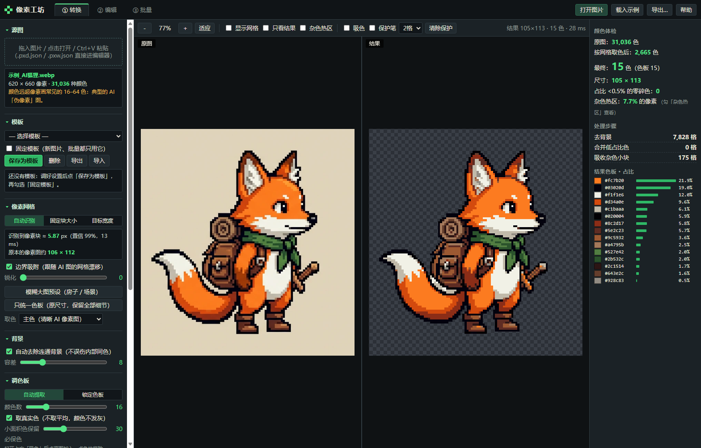
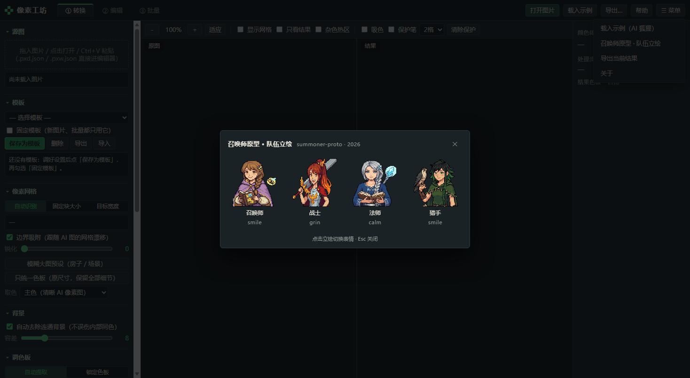

# Pixel Workshop

[中文](README.zh-CN.md) | **English** | [日本語](README.ja.md)

> v1.4.0 · MIT · single-file, offline · [Download latest](https://github.com/CHET-LI/pixel-workshop/releases/latest)

Pixel Workshop turns AI-generated "pixel-style" images into **real pixel art** — recovered pixel grid, clean palette, crisp edges — and gives you a small editor to repaint the parts the converter cannot fix.

One self-contained HTML file. Double-click it in Chrome / Edge. No install, no build step, nothing is uploaded anywhere.

## What it solves

An AI "pixel image" only looks like pixels: each block holds dozens of near-identical colours, edges are anti-aliased, and the grid does not line up. Resize it down and it blurs; reduce the colours directly and detail is crushed. The pipeline is:

1. **Recover the grid** — estimate the block size from edge peaks (the bundled sample measures 5.87px at 99% confidence), then snap every grid line to the real edge so the grid can follow AI drift.
2. **One colour per cell** — sample the cell centre only and vote by colour bucket, so anti-aliased blends never win.
3. **Remove the background** — flood from the border, so same-coloured regions *inside* the character survive.
4. **Snap to a palette** — auto-extract N colours (real colours, no greying out, near-duplicates merged), or lock your own palette (presets / `.gpl` `.pal` `.hex` / pasted hex values / extracted from a reference image).
5. **Clean only the noise** — low-share colours merge into the nearest colour; small blobs are absorbed only by *similar* colours, so eye highlights and other high-contrast single pixels stay. Anything painted with the protect brush is never touched.
6. Optional: unify outline colour, drop L-corners on outlines, add a 1px outer outline, trim transparent borders.

## Blurry big images (v1.1, e.g. game building textures)

House-sized images have usually been resized, so the grid is gone for good. The tool detects these and switches to **re-pixelate**:

- **Auto-applies the "blurry big image" preset** (also available as a button): thin-line-safe sampling (window frames and outlines survive), 40+ colours, keep small-area colours (plants), denoise, export at original size.
- **Block size**: use the measured pseudo-grid when it is obvious, otherwise 3px.
- **Original-size export**: `*_pixel_原尺寸.png` from the convert page, or "original size PNG" in the editor's export menu. Same dimensions and position as the source — drop it straight back into the game. Works in batch too.
- **Eyedropper → must-keep colours**: badges, flowers and lamps are tiny but important. Pick a pixel in the source and that colour is guaranteed to enter the palette.
- Optional sharpening (off by default — it adds noise).
- **"Snap palette only (original size, keep all detail)"**: for AI scene art that is already clean but has too many colours. No re-blocking, every source pixel kept, no noise cleanup, no background removal — only colours snap to the palette (e.g. 400k → 37 colours). Visually similar to a huge target width (say 5000px) but without changing the size.
- Limitation: detail smaller than one block that the source already blurred (a 1–2 cell flower) cannot be recovered — fix it by hand in the editor.
- Best input is still the **raw AI output** before any resizing; that is where the grid can be recovered (99% confidence on the bundled sample).

## Templates (v1.2)

- **Convert → Templates → Save as template** stores every setting: grid mode and block size, sampling, background, palette mode and locked palette, must-keep colours, noise cleanup, outline, export options (including original size) and batch scale. Same name overwrites.
- **"Pin template"**: new images — opened, dropped or pasted — and every batch item use exactly this template. The tool stops auto-switching grid mode, block size or the blurry preset, and batch no longer guesses per image, so results match single conversions.
- Changing a setting while pinned shows "settings changed"; the next image returns to the template.
- Templates and the pin live in browser storage and survive restarts. **Export / import** writes them to a `.json` for moving between machines or browsers.

## PXD pixel data and code-driven animation (v1.3)

`.pxd.json` is a plain-text pixel format: a palette plus one character per pixel, with layers, frames and metadata (anchors, part maps). Scripts and agents can read and write it directly — see **`WORKFLOW.md`**.

- **Export** "pixel data .pxd.json" from either the convert page or the editor (the editor keeps all layers and frames).
- **Open** `.pxd.json` and project files `.pxw.json` by dragging them onto the window or via the open button; they land in the editor with metadata intact.
- **`cli/pw.js`** (Node, same `core.js` algorithms as the web app):
  - `convert` — AI image → PXD, optionally with a template exported from the web UI;
  - `topxd` — PNG(s) → PXD, several images as frames or layers;
  - `render` — PXD → per-frame PNGs, sprite sheet, GIF;
  - `info`, `frompxw`.
- **`cli/pxanim.py`** (Python): PXD I/O, part maps as a second layer you can edit in the app, shift/compose/RotSprite rotation/mirror, all colours constrained to the original palette.
- **Example `examples/feng_warrior/`**: idle 2 frames + run 6 frames. v1.4 replaces the art with the new design (front 128×258, back 122×259, converted by Pixel Workshop itself) and `feng_anim.py`'s part coordinates were re-tuned to the new proportions; side-view source art is still missing, so left/right are not generated yet.

## Menu and the summoner prototype portraits (v1.4)

`☰ Menu` at the right end of the top bar:

- **Load sample (AI fox)**, **Export current result**, **About** — same as the existing buttons.
- **Summoner prototype · party portraits**: a panel with four portraits (Summoner / Warrior / Mage / Ranger); click one to cycle to that character's next expression, the footer shows the current character and expression, `Esc` closes. The art comes from the same author's other project `summoner-proto`, included as a real-world example.

All portraits are inlined (~290KB), so the file stays offline and self-contained.

## Three pages

- **① Convert** — side-by-side before/after with synchronised zoom and pan, optional grid overlay. The **noise heat map** outlines over-noisy regions worth repainting by hand. Right side: colour audit, processing steps, palette shares.
- **② Edit** — pixel-perfect pencil, eraser, dither pen, fill, eyedropper, line, rectangle, ellipse, dither gradient, marquee, magic wand, move, background wand, recolour; X/Y mirror and tile preview; layers (opacity, merge), animation frames (onion skin, playback), 60-step undo; double-click a swatch to recolour the whole drawing; **selection → new layer** so you can repaint a face or a weapon while comparing against the original.
- **③ Batch** — one setting for a whole folder, ZIP output with `palette.gpl`. Pin a template for consistent results.

## Export

PNG at 1–8× nearest-neighbour, sprite sheet, transparent GIF, per-frame PNG ZIP, palettes `.gpl` / `.hex` / PNG, project `.json` you can reopen and keep editing.

## Repository layout

- `PixelWorkshop.html` — the whole tool, single file, sample image embedded.
- `src/` — source: `core.js` (pure algorithms, runs under Node), `app1.js` / `app2.js` (UI), `index.html`, `style.css`.
- `cli/` — `pw.js` CLI, `pxanim.py` animation library; `WORKFLOW.md` covers pixel art → code animation.
- `build.py` — inlines `src/` into the single HTML (also embeds the sample and the portraits).
- `tests/` — algorithm tests, browser UI tests (convert, templates, game-building textures, PXD round-trip).

## License

MIT — see [LICENSE](LICENSE). Use it, change it, ship it commercially; keep the copyright notice when redistributing.