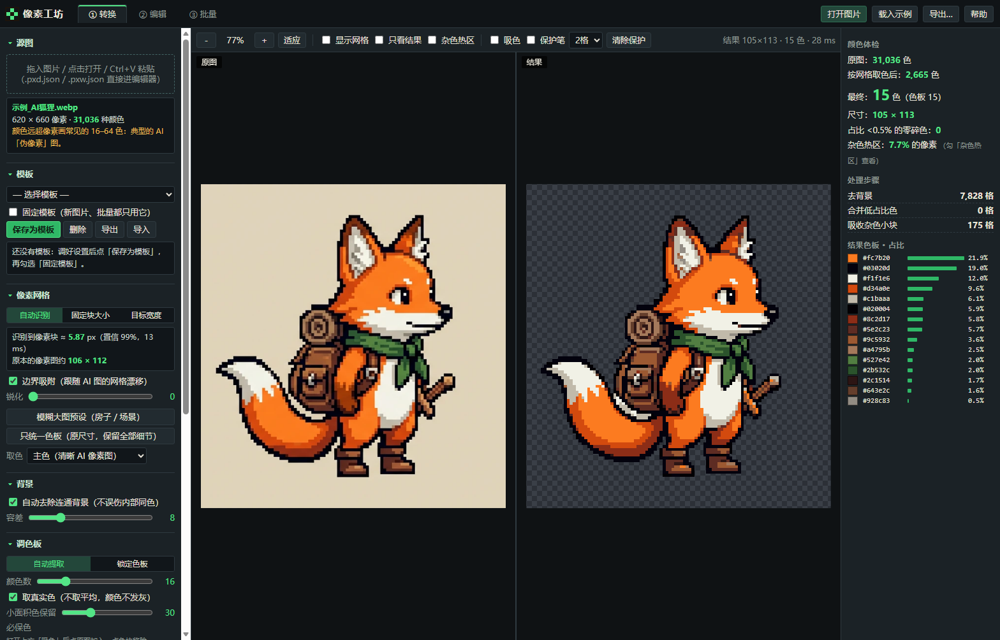
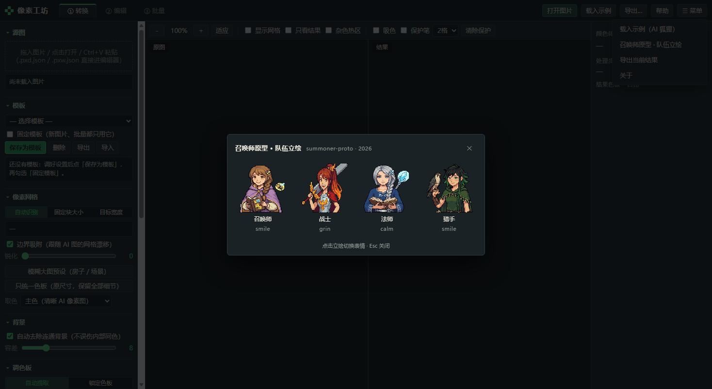

# 像素工坊 Pixel Workshop

**中文** | [English](README.md) | [日本語](README.ja.md)（欢迎补翻译 / translations welcome）

> v1.5.0 · MIT · 单文件离线运行 · [下载最新版](https://github.com/CHET-LI/pixel-workshop/releases/latest)

把 AI 生成的“像素风”图整理成**真正的像素画**（统一色板、边界清楚），再用内置编辑器**局部重画**。
单个 HTML 文件，双击用浏览器（Chrome / Edge）打开即可，离线运行，图片不会上传。

> **English** — Pixel Workshop turns AI-generated "pixel-style" images into real pixel art:
> it recovers the pixel grid, snaps colours to a palette, lets you repaint locally, and exports
> sprite sheets / GIFs or a plain-text pixel format (`.pxd.json`) that scripts and agents can
> read and animate. Single self-contained HTML file — no install, no build, runs offline.

## 解决的问题
AI 的“像素图”只是看起来像：一个像素块里有几十种相近色、边缘有抗锯齿、网格不严格对齐。
直接缩小会糊，直接减色会丢细节（压过头）。本工具的处理顺序：

1. **找回像素网格**：用边缘峰值测出块大小（示例图 5.87px，置信 99%），再让每条格线吸附到真实边缘，跟住 AI 图的网格漂移。
2. **每格取主色**：只看格子中心区域，并用颜色分桶投票，抗锯齿的混色进不来。
3. **自动去背景**：从边框连通地去掉背景，角色内部的同色区域不会被误删。
4. **吸附色板**：可以自动提取 N 色（取真实色，不发灰，近似色自动合并），也可以锁定你的色板（预设 / 导入 .gpl .pal .hex / 粘贴色值 / 从参考图提取）。
5. **只清理杂色**：占比很低的颜色并入最接近的颜色；小杂块只被**相近色**吸收，眼睛高光这类反差大的单像素会保留。「保护笔」涂过的地方完全不动。
6. 可选：统一描边色、描边去 L 角、加 1px 外描边、裁掉透明边。

## 模糊的大图（v1.1，例如游戏里的房子贴图）
房子这类图一般被缩放过，像素网格已经不存在了，找不回来。打开这类图时工具会自动识别，改用「重新像素化」：

- **自动套用「模糊大图预设」**，也可以手动点按钮套用。预设包括：
  - 细线保护取样：窗框、描边这类细线不会被吃掉；
  - 40+ 色；
  - 保留小面积色：绿植等颜色不会被大块面挤掉；
  - 去噪点；
  - 按原尺寸导出。
- **块大小**：图里残留的伪网格够明显，就用测出的值；不明显就用 3px。
- **原尺寸导出**：转换页导出 `*_pixel_原尺寸.png`，编辑器导出菜单也有「原图尺寸 PNG」。尺寸、位置和原图完全一致，可以直接替换游戏里的贴图。批量页同样适用。
- **吸色 → 必保色**：徽章、小花、灯火这类面积很小但重要的颜色容易被挤掉。打开「吸色」后点一下原图上的位置，这个颜色就一定会进色板（锁定色板模式下则直接加入色板）。
- 可选锐化：默认关闭，打开后容易起噪点。
- **「只统一色板（原尺寸，保留全部细节）」**：本身比较清楚、只是颜色太杂的 AI 场景图用这个。它的做法：
  - 不重新分块，每个原图像素都保留（1px）；
  - 不清理杂点，不去背景；
  - 只把颜色吸附到色板上，比如 40 万色压到 37 色。

  效果相当于用一个很大的「目标宽度」（比如 5000px）处理，但尺寸不变、像素均匀、显存小得多。游戏里放大请用整数倍加最近邻。用过这个预设后，之后打开的模糊图会继续沿用它；遇到有清晰网格的图，会自动切回「自动识别」。
- 局限：比一个像素块还小、又已经被原图糊掉的细节（比如 1–2 格大的小黄花）算法救不回来，送到编辑器里手工点几下即可。
- 最好的来源仍然是 **AI 的原始输出**（还没缩放过的图），这种图网格能找回（示例狐狸的识别置信度是 99%）。

## 模板（v1.2）
调好一套满意的设置后，可以存成模板，以后一直用它：
- 「转换」页左侧「模板」→「保存为模板」：保存全部设置，包括网格模式和块大小、取色方式、背景、色板模式和锁定的色板、必保色、杂色清理、描边、导出方式（含原尺寸），以及批量倍率。同名会覆盖。
- **勾选「固定模板」**：之后打开、拖入、粘贴的新图片，还有批量处理，都严格按这个模板来。工具不再按图片自动切换「自动识别」、改块大小或套用「模糊大图预设」。批量里每张图也不再单独猜块大小，所以和单张转换的结果一致。
- 固定期间临时改了参数，会提示「设置改过」；下一张图会恢复成模板设置。想保留改动就再点一次「保存为模板」覆盖。
- 模板和固定状态存在浏览器里，关掉页面再打开仍然有效。「导出 / 导入」可以把模板存成 .json 文件，换电脑或换浏览器时用。
- 批量页顶部也能直接选模板、勾选固定，摘要会显示「模板：固定「名字」」。
- 不勾选固定时，行为和 v1.1 一样（按图片自动调整）。

## 像素数据 PXD 与代码动画（v1.3）
v1.3 新增一种纯文本像素数据格式 **`.pxd.json`**：色板 + 每像素一个字符，含图层、帧和 meta（锚点、部位表等）。脚本和 AI 代理可以直接读写它，完整流程见 **`WORKFLOW.md`**。

- **导出**：「转换」页和编辑器都可以导出「像素数据 .pxd.json」。编辑器导出时保留全部图层和帧。
- **打开**：`.pxd.json` 和项目文件 `.pxw.json` 可以直接拖进窗口，或者用「打开图片」按钮打开，会进入编辑器。meta 原样保留。
- **命令行 `cli/pw.js`**（node，和网页同一套 core.js 算法）：
  - `convert`：AI 图 → PXD，可以套用网页导出的模板；
  - `topxd`：PNG → PXD，多张图可以作为多帧或多层；
  - `render`：PXD → 逐帧 PNG、精灵表、GIF；
  - `info`：查看图片或 PXD 的信息；
  - `frompxw`：编辑器项目 → PXD。
- **动画库 `cli/pxanim.py`**（Python）：
  - 读写 PXD；
  - 部位图：两层 PXD，人可以在编辑器里修改；
  - 平移、叠图、RotSprite 旋转、镜像；
  - 所有操作只用原色板里的颜色。
- **示例 `examples/feng_warrior/`**：凤笑天城镇小人 → 待机 2 帧 + 跑步 6 帧。v1.4 换成新立绘（正面 128×258、背面 122×259，由像素工坊自己转出来的），`feng_anim.py` 的部位坐标已按新比例重调；侧身源图还没给，左右两方向暂缺。附部位图、脚本、精灵表、GIF 和 JSON。
- **测试**：
  - `tests/core.test.js` 共 20 项，其中 PXD 往返 6 项；
  - `tests/ui_pxd.py` 共 7 项：打开 PXD → 编辑器 → 导出，像素、帧时长、meta 都完全一致；转换页也能导出 PXD。

## 菜单与召唤师原型立绘（v1.4）
顶栏右端新增 `☰ 菜单`：

- **载入示例（AI 狐狸）**、**导出当前结果**、**关于**：和原来按钮等价，只是多一个入口。
- **语言 / Language**：整份界面在中文和英文之间切换，选择记在浏览器里，下次打开还是它。
- **召唤师原型 · 队伍立绘**：弹出面板，横排四张立绘（召唤师 / 战士 / 法师 / 猎手），点一张就切到该角色的下一个表情，底部显示当前角色和表情名，`Esc` 关闭。素材来自同一个作者的另一个项目 `summoner-proto`，作为真实用例放在这里。

## 三个页面
- **① 转换**：左右对比（同步缩放和平移，可显示网格）。**杂色热区**用橙框标出颜色过杂的位置，这些地方适合手工重画。右侧是颜色体检、处理步骤和色板占比。
- **② 编辑**：
  - 工具：铅笔（像素完美）、橡皮、抖动笔、填充、吸管、直线、矩形、椭圆、抖动渐变、框选、魔棒、移动、去底魔棒、换色。
  - 左右 / 上下对称，平铺预览。
  - 图层（不透明度、合并）、动画帧（洋葱皮、播放），撤销 60 步。
  - 双击色板改色，可联动替换画面中的该色；「吸附到色板」。
  - **选区→新图层**：把五官、武器等部位单独拿出来重画，隐藏旧层对比。
- **③ 批量**：整个文件夹套用同一套设置，打包 ZIP（附 palette.gpl）。做成套素材时，先保存模板并勾选「固定模板」：整批用完全相同的设置。没固定时，每张图会自动识别网格。

## 导出
PNG 1–8 倍最近邻放大、精灵表、GIF 动画（透明）、逐帧 PNG 的 ZIP、色板 .gpl / .hex / PNG、项目 .json（可以再打开继续编辑）。

## 推荐流程
AI 出图 → 转换（检查块大小，挑色板，调杂色清理，涂保护）→ 送到编辑器（魔棒选部位 → 新图层重画 → 统一换色）→ 导出。

## 文件
- `PixelWorkshop.html`：完整工具，单文件，内置示例图。
- `src/`：源码。`core.js` 是纯算法，可以在 node 下跑；`app1.js` / `app2.js` 是界面。
- `cli/`：命令行 `pw.js`、Python 动画库 `pxanim.py`。`WORKFLOW.md`：像素图 → 代码动画工作流。
- `build.py`：把 src 内联成单个 HTML。`tests/`：算法测试 14 项、浏览器 UI 测试 20 项、模板测试 21 项（`ui_template.py`）、游戏房子贴图测试 12 项（`ui_house.py`）。
  
## 许可

MIT License — 见 [LICENSE](LICENSE)。工具、源码和示例都可以自由使用、修改、商用；转载或二次分发请保留版权声明。
